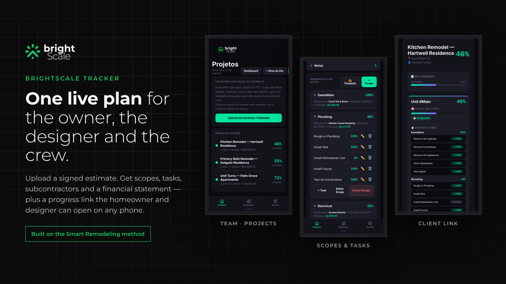
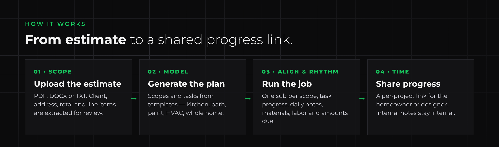
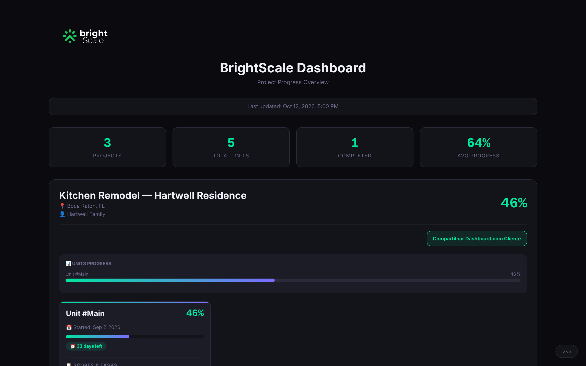
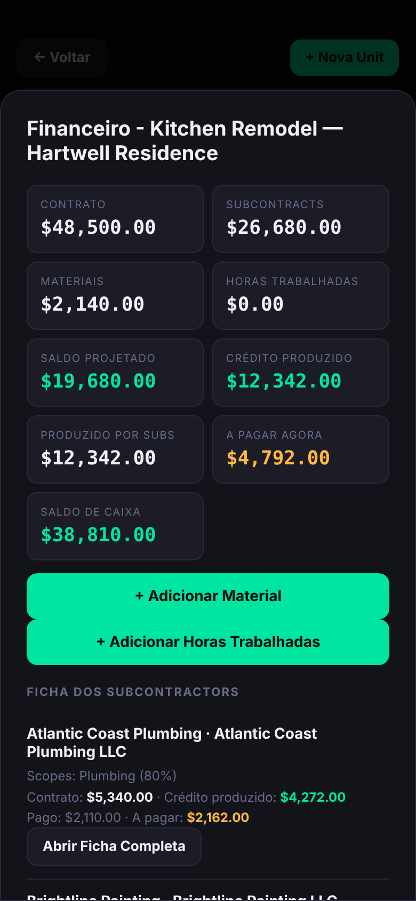

  

  <a href="https://libanius.github.io/BrightScale-Tracker/"><b>Open the app</b></a> ·
  <a href="#how-it-works">How it works</a> ·
  <a href="#the-smart-remodeling-method">Smart Remodeling</a> ·
  <a href="#technical-documentation">Technical docs</a>

---

## FOR IMMEDIATE RELEASE

# BrightScale introduces BrightScale Tracker, a project-control app that turns a signed remodeling estimate into one live plan for the homeowner, the designer and the crew

**Built by a working construction project manager, the app puts BrightScale's Smart Remodeling method into software: defined scopes, accountable subcontractors, clear finances and progress the client can see.**

**PARKLAND, Fla. — October 2026 —** BrightScale Contractor today presented **BrightScale Tracker**, a mobile-first web app that helps remodeling contractors run a job from the signed estimate to the final walkthrough, and share real progress with the people paying for it.

Remodeling rarely fails on craftsmanship. It fails on coordination: a scope nobody wrote down the same way twice, a subcontractor whose status lives in a text thread, a budget that is only reconciled at the end, and a homeowner or interior designer who hears about progress only when they ask. BrightScale Tracker replaces that with a single plan every party works from.

A contractor uploads the estimate or contract — PDF, DOCX or plain text — and the app extracts the client, address, contract total and line items for review. From there it builds the project: units, scopes and tasks, starting from ready-made templates for kitchens, bathrooms, whole-home remodels, paint jobs and HVAC installations. Each scope is assigned to one subcontractor, so responsibility is never shared and never vague.

As work moves, the crew updates task progress from a phone. The app turns that progress into money: every scope carries the agreed subcontract amount and what has been paid, and BrightScale Tracker calculates the credit each sub has actually produced and what is due right now, next to material and labor costs and the projected margin on the job.

With one tap, the contractor sends the homeowner or designer a **progress link** for their project only. The page shows scopes, tasks, percent complete and days left, and leaves out the contractor's internal notes and financials.

> "I spent years managing multifamily renovations where the real problem was never the work — it was everyone holding a different version of the plan. BrightScale Tracker is how I run my own jobs now: one scope, one standard, one schedule, and a link I can send the owner and the designer so they see what my crew sees."
> — **Paulo Libânio Neto**, founder of BrightScale Contractor

BrightScale Tracker is in daily use on BrightScale's own residential and commercial projects in South Florida and is being prepared as a product for remodeling contractors, interior designers and property managers.

---

## How it works

| | Step | What happens |
|---|---|---|
| **01** | **Upload the estimate** | PDF with selectable text, DOCX, TXT or Markdown. Client, address, total and work items are extracted and shown for review before anything is created. The original file stays on the device. |
| **02** | **Generate the plan** | Project → units → scopes → tasks, from templates (kitchen, bathroom, home remodel, paint job, HVAC) or from the estimate's own line items. |
| **03** | **Run the job** | One active subcontractor per scope; task progress; daily notes ("Journey de Hoje"); materials, helper hours and subcontract payments. |
| **04** | **Share progress** | A per-project link for the homeowner or designer, always in sync with the team dashboard. Internal notes are never rendered on it. |

### For the crew and the PM — every project, unit and scope in one place

### For the owner — the money, scope by scope

`produced credit = (agreed amount × scope progress) + hours worked`

Contract revenue, subcontract commitments, materials, labor, projected balance, produced credit, amount payable now and cash balance — per project and per subcontractor.

---

## The Smart Remodeling method

BrightScale Tracker is the software form of **Smart Remodeling**, the structured approach Paulo developed managing thousands of units of renovation work.

| | Principle | In the app |
|---|---|---|
| **S** | **Scope** — work, deliverables and expectations defined from the start | Estimate import and review; scopes and tasks created before work begins |
| **M** | **Model** — an agreed reference for materials, finishes and workmanship | Templates per job type; the estimate stays attached to the project |
| **A** | **Alignment** — client goals, crew responsibilities and materials on one shared plan | One subcontractor per scope; the same data drives the team view and the client link |
| **R** | **Rhythm** — consistent workflow with progress reviews and communication | Task progress, daily notes, team dashboard |
| **T** | **Time** — realistic schedule, clear milestones, active deadline management | Start dates, deadlines and days-left on every unit |

*A clear plan. A defined standard. A better remodeling experience.*

---

## Who it's for

- **Remodeling and handyman contractors** that work through subcontractors and need to see every scope and every dollar.
- **Interior designers** who want to follow their clients' projects without chasing the contractor.
- **Homeowners** who want to know where the job stands today.
- **Property managers** running unit turns across multifamily buildings.

## Status and roadmap

**Today (MVP, in production use):** installable PWA on iPhone and Android · estimate import · templates · subcontractor registry · project and subcontractor financials · versioned backups and restore · conflict protection between devices · private, revocable per-project client links · cloud sync with sign-in.

**Next:**
- Owner and subcontractor portals with milestone approval, e-signature and Stripe payment links
- Multi-company accounts so other contractors can use it as SaaS
- OCR for scanned estimates
- English and Spanish interface (the app UI is currently in Portuguese)
- AI assistance to draft scopes and tasks from free-form estimates

## Built with

Vanilla JavaScript PWA · IndexedDB (offline-first cache) · Supabase (Postgres with row-level security, email sign-in, realtime, Edge Functions) · Cloudflare Pages hosting.

## Contact

**BrightScale Contractor** · [brightscalegroup.com](https://www.brightscalegroup.com) · contact@brightscalegroup.com · 954-553-9535
Serving Miami-Dade, Broward and Palm Beach.

Screenshots use fictional demo projects.

---

## AI project continuity — Smart Remodeling 2.0

**For ChatGPT, Claude, Codex, GitHub Copilot and future contributors:** read the [canonical living handoff (34 approved decisions, MVP checkpoint, next step)](docs/SMART_REMODELING_HANDOFF_2026-10-26.md) and the [cross-LLM continuity protocol](docs/CONTINUITY_PROTOCOL.md) **before changing the application**. [AGENTS.md](AGENTS.md) provides concise operating rules for coding agents.

The product-planning interview is closed. Focus on a small field-tested MVP. Update the **same canonical handoff** with verifiable implementation, test results, blockers, and next step after meaningful sessions. Documentation is **not** automatic background monitoring.

## Technical documentation

The app's interface is currently in Portuguese; UI labels are shown as **English (Portuguese)**.
Guides: [Cloud and sign-in](CLOUD-GUIDE.md) · [Creating custom templates](TEMPLATES-GUIDE.md)

**Where things live**

- Code: `libanius/BrightScale-Tracker` (this repository). It contains **no project data**.
- Data: Supabase project `brightscale-scanner`, schema `tracker` (projects, units, scopes, tasks, expenses, people, notes, share links). See [CLOUD-GUIDE.md](CLOUD-GUIDE.md).
- `tracker-cloud.js`: the cloud layer shared by the app and the dashboard (sign-in, sync outbox, realtime, share links).
- Edge Function `tracker-share`: creates per-project links and serves the client-safe view.

### Importing contracts and estimates

On the home screen, **Upload Contract / Estimate (Upload de Contrato / Estimate)** accepts:

- PDF with selectable text
- DOCX
- TXT or Markdown

The app extracts the client, address, total and work items, lets you review the fields, and then creates the project, unit, scopes and tasks automatically. The original file is stored only in the device's IndexedDB and is never published to the GitHub dashboard.

Scanned (image-only) PDFs still need OCR before they can be imported.

### Data across devices

Sign in with your email (magic link or 6-digit code). Every edit is saved on the device first and sent to the cloud right away; if the phone is offline, changes wait in a queue and go out when the connection returns. Other devices and the team dashboard update live. **Settings → Account & Cloud (Conta e Nuvem)** shows the sync status and has **Sync now (Sincronizar agora)**. Local JSON export/import in Reports is still available.

### Client dashboard

The team dashboard (sign-in required) shows every project. Each project card has **Share Dashboard with Client (Compartilhar Dashboard com Cliente)**, which creates a private link (`dashboard.html?t=…`) for that project only. The link shows scopes, tasks, progress and dates — never money, subcontractor details or internal notes — and can be revoked. Links from the old system (`?project=`) are disabled.

### Project financials

Each project has a statement with contract revenue, subcontractor commitments, material expenses, hours worked and projected balance. On each scope you can set the responsible subcontractor, the agreed amount and the amount already paid. Helper hours can be logged by name, hourly rate, quantity, date and an optional scope. Produced credit is calculated automatically from scope progress:

`produced credit = (agreed amount × scope progress) + hours worked`

Financial records are included in both local and versioned GitHub backups.

### Subcontractors

Subcontractors are registered only in Settings, with name, company, email and Active/Inactive status. Each scope can select a single active subcontractor from the list, and every task in that scope falls under that subcontractor. Tasks have no owner of their own.

In Settings, **Open Subcontractor Registry (Abrir Cadastro de Subcontractors)** lets you look up, edit, activate or deactivate subcontractors and open their consolidated financial statement. Registrations and assignments are also included in backups. Names previously typed directly on scopes are migrated automatically as active subcontractors.
